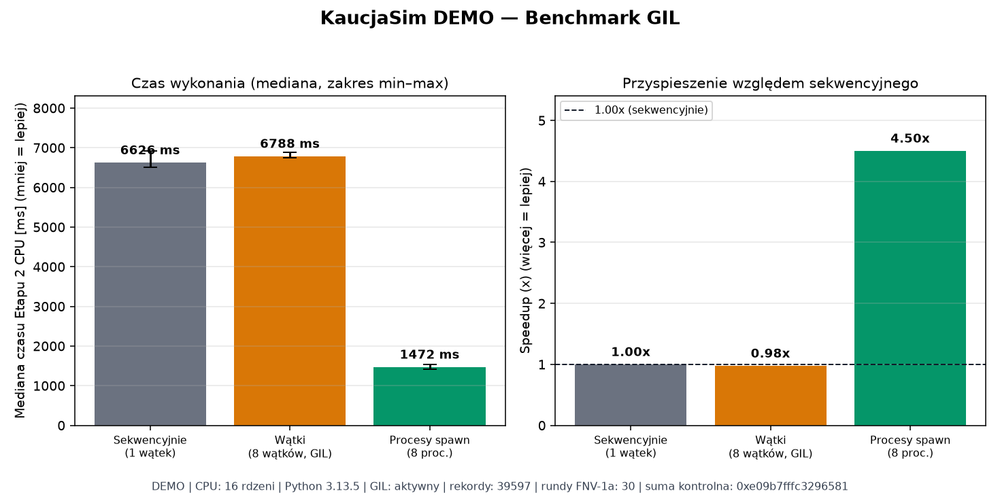

# KaucjaSim — Symulator polskiego systemu kaucyjnego (DEMO)

**KaucjaSim** to lokalny, interaktywny symulator polskiego systemu kaucyjnego w trybie **DEMO**, zbudowany w Pythonie 3.13+ (`FastAPI`, `uvicorn`, `matplotlib`) z interfejsem webowym HTML/CSS/vanilla JS oraz narzędziami CLI (`argparse`).

Aplikacja udostępnia trzy widoki w jednej powłoce przeglądarkowej:
1. **Butelkomat (`DEMO • Automat`)** — wrzucanie i przeciąganie gotowych kart opakowań (PET, puszka, szkło, przypadki odrzucenia i duplikaty ID egzemplarza), walidacja w czasie rzeczywistym i wystawianie numerowanego bonu DEMO ważnego 100 dni z widokiem do druku/PDF.
2. **Kasa Sklepowa (`DEMO • Kasa`)** — kompletowanie koszyka zakupowego, przyjmowanie butelek szklanych wielokrotnego użytku (do 1,5 l, `+1,00 zł`), przegląd statusów bonów (`AKTYWNY`, `ZUŻYTY`, `WYGASŁY`) oraz rozliczanie bonu na zakupy lub wypłatę gotówki DEMO.
3. **Analityka i Benchmark GIL (`DEMO • Benchmark`)** — prezentacja wyników referencyjnych i wykresu PNG, uruchamianie na żywo generatora logów, dwuetapowej analizy wsadowej (wątki I/O + procesy CPU) oraz porównawczego benchmarku GIL.

> **Granice trybu DEMO:** Aplikacja jest edukacyjnym symulatorem działającym lokalnie bez bazy SQL, ORM, kont użytkowników, kamery/OCR ani integracji z prawdziwymi drukarkami fiskalnymi lub operatorami kaucyjnymi. Stan sesji i bonów zapisywany jest w plikach JSON/JSONL, a każdy ekran, bon i wydruk nosi wyraźne oznaczenie **`DEMO`**.

> **Wersja demonstracyjna online (opcjonalna):** *w przygotowaniu — publiczny adres DEMO zostanie uzupełniony po osobnym wdrożeniu.*

---

## Wymagania i uruchomienie

- **Wymagania:** Python **3.13+**, nowoczesna przeglądarka desktopowa, menedżer [`uv`](https://docs.astral.sh/uv/) (ścieżka zalecana) albo standardowe `venv` + `pip` z plikiem `requirements.txt`.
- **Opcjonalnie:** Node.js (np. 20+) do uruchomienia klienckich testów JavaScript (`node --test`).

### Ścieżka zalecana (`uv`)

```bash
uv sync
uv run kaucjomat serve
```

Po starcie otwórz w przeglądarce `http://127.0.0.1:8000`. Samo polecenie `uv run kaucjomat` (bez podkomendy) wyświetla pomoc CLI.

### Ścieżka alternatywna (`venv` + `requirements.txt`)

Plik `requirements.txt` zawiera wyłącznie zamrożone zależności runtime (bez samego pakietu `kaucjomat` i bez paczek deweloperskich), dlatego po instalacji zależności należy zainstalować pakiet lokalnie flagą `--no-deps -e .`:

**Windows (PowerShell):**

```powershell
python -m venv .venv
.\.venv\Scripts\Activate.ps1
pip install -r requirements.txt
pip install --no-deps -e .
kaucjomat serve
```

**macOS / Linux:**

```bash
python3 -m venv .venv
source .venv/bin/activate
pip install -r requirements.txt
pip install --no-deps -e .
kaucjomat serve
```

### Podkomendy CLI i zmienne środowiskowe

Wszystkie polecenia przyjmują flagi globalne `--log-level {DEBUG,INFO,WARNING,ERROR,CRITICAL}` oraz `--log-file <ścieżka>`.

| Podkomenda | Przeznaczenie | Najważniejsze flagi |
|---|---|---|
| `kaucjomat info` | Diagnostyka Pythona, `os.cpu_count()`, ścieżek i widoków DEMO | `--log-level`, `--log-file` |
| `kaucjomat serve` | Start serwera webowego FastAPI / Uvicorn | `--host`, `--port`, `--reload` |
| `kaucjomat generate-logs` | Generator syntetycznych plików `.log` do analizy wsadowej | `--log-dir`, `--files`, `--records-per-file`, `--invalid-ratio`, `--seed`, `--json` |
| `kaucjomat analyze-logs` | Dwuetapowa analiza logów (wątki I/O + procesy `spawn`) | `--log-dir`, `--chunk-size`, `--io-workers`, `--cpu-workers`, `--work-iterations`, `--no-auto-generate`, `--json` |
| `kaucjomat benchmark-gil` | Porównanie: sekwencyjnie vs wątki vs procesy `spawn` + wykres PNG | `--log-dir`, `--output-dir`, `--repeats`, `--workers`, `--chunk-size`, `--io-workers`, `--work-iterations`, `--no-auto-generate`, `--json`, `--save-reference` |

> **Uwaga:** Flaga `--save-reference` w `kaucjomat benchmark-gil` nadpisuje wersjonowane w repozytorium pliki referencyjne w `src/kaucjomat/data/reference/` i nie powinna być używana podczas zwykłych testów lokalnych.

Obsługiwane zmienne środowiskowe serwera webowego:
- `PORT` — numer portu TCP (domyślnie `8000`, nadpisywany flagą `--port`),
- `KAUCJOMAT_STATE_FILE` — opcjonalna ścieżka do pliku stanu JSON (domyślnie `data/generated/state/return_state.json`),
- `KAUCJOMAT_ANALYTICS_DIR` — opcjonalny katalog roboczy dla przebiegów analityki i benchmarku z UI (domyślnie `data/generated/web_analytics`),
- `KAUCJOMAT_LOG_LEVEL` oraz `KAUCJOMAT_LOG_FILE` — poziom oraz opcjonalny plik logów odtwarzane także w procesie potomnym `--reload`.

### Uruchomienie testów

```bash
uv run pytest -q
node --test tests/analytics_client.test.js tests/checkout_glass_client.test.js
```

---

## Mapowanie 8 zagadnień Pythona na kod

| # | Zagadnienie | Gdzie w kodzie (plik → klasa / funkcja) | Rola domenowa w KaucjaSim |
|---:|---|---|---|
| 1 | Dekoratory funkcji (`≥ 2`, w tym z parametrami, `functools.wraps`) | `src/kaucjomat/decorators.py` → `log_deposit_attempt`, `enforce_latency_budget(max_ms)` użyte na `evaluate_package_return` w `src/kaucjomat/return_domain.py` | Audyt każdej próby wrzutu w logu oraz pomiar budżetu opóźnienia skanera butelkomatu (`<= 200 ms`) z zapisem czasu do decyzji. |
| 2 | Dekorator metody z `self` oraz `@property` z setterem / `@classmethod` | `src/kaucjomat/checkout_guards.py` → `require_active_voucher` użyty na `VoucherSettlement.settle` w `src/kaucjomat/checkout_domain.py`; tamże `BasketItem.quantity` (`@property` + `@quantity.setter`), `Basket.from_items` i `GlassReturn.from_count` (`@classmethod`) | Strażnik stanu bonu odczytujący `self.voucher` i `self.now` przed rozliczeniem, walidacja ilości sztuk `1–99` oraz fabryki koszyka i zwrotu szkła. |
| 3 | Iterator (`__iter__`, `__next__`, `StopIteration`) | `src/kaucjomat/batch_patterns.py` → `BatchChunkIterator` (używany w `src/kaucjomat/batch_runner.py` → `read_and_chunk_logs_threaded`) | Strumieniowe porcjowanie rekordów logów zwrotów w stałe paczki robocze (`chunk_size`) przekazywane do etapu obliczeń CPU. |
| 4 | Generator (`yield`) i wyrażenia generujące | `src/kaucjomat/batch_patterns.py` → `iter_raw_log_lines` (`stripped_lines` + `yield`), `stream_valid_log_records`; wyrażenia generujące także w `src/kaucjomat/return_patterns.py` (`is_valid_ean13_checksum`) i `src/kaucjomat/checkout_domain.py` (`Basket.total_grosze`) | Leniwy odczyt i filtrowanie dużych plików `.log` bez ładowania ich w całości do pamięci oraz zwięzłe sumowanie cyfr EAN-13 i wartości koszyka. |
| 5 | Wyrażenia regularne (`re`) z grupami nazwanymi `(?P<...>)` | `src/kaucjomat/return_patterns.py` → `PACKAGE_CODE_RE`, `INSTANCE_SERIAL_RE` (`parse_package_code`, `parse_instance_serial`); `src/kaucjomat/batch_patterns.py` → `BATCH_LOG_LINE_RE` (`parse_batch_log_line`) | Rozbiór i walidacja struktury kodu etykiety kaucyjnej (kraj, znak `KAUCJA`/`BEZLOGO`, EAN-13, ID egzemplarza) oraz parsowanie linii logów wsadowych. |
| 6 | Wątki I/O z synchronizacją (`ThreadPoolExecutor`, `Lock`, `Queue`) | `src/kaucjomat/batch_runner.py` → `read_and_chunk_logs_threaded`; `threading.Lock` również w `src/kaucjomat/return_store.py` (`ReturnStateStore`) i `src/kaucjomat/analytics_jobs.py` (`AnalyticsJobManager`) | Współbieżne wczytywanie wielu plików `.log` z bezpiecznym kolejkowaniem porcji (`queue.Queue`) i agregacją statystyk pod `threading.Lock`. |
| 7 | Procesy CPU-bound (`ProcessPoolExecutor`, `spawn`, osłona `__main__`) | `src/kaucjomat/batch_runner.py` → `compute_analytics_multiprocess`; `src/kaucjomat/batch_cpu.py` → `compute_record_audit_signature`, `analyze_record_chunk`, `merge_chunk_results`; wejście `src/kaucjomat/__main__.py` i `src/kaucjomat/cli.py` | Równoległe obliczanie statystyk oraz wielorundowej 64-bitowej sumy kontrolnej FNV-1a w niezależnych procesach `spawn` na Windows i macOS. |
| 8 | Benchmark GIL + detekcja rdzeni i wykres PNG | `src/kaucjomat/gil_benchmark.py` → `collect_gil_environment_info` (`os.cpu_count()`), `compute_analytics_threaded`, `run_gil_benchmark`; `src/kaucjomat/gil_chart.py` → `render_gil_benchmark_chart`; `src/kaucjomat/gil_conclusions.py` → `build_conclusions`, `build_single_core_warning` | Porównanie tego samego zadania CPU-bound (sekwencyjnie vs wątki vs procesy `spawn`), weryfikacja spójności sumy kontrolnej, wykres PNG i dobór wniosków. |

---

## Wyniki pomiarów wydajności GIL i wnioski

Referencyjny pomiar zapisano w `src/kaucjomat/data/reference/gil_benchmark_reference.json` oraz `src/kaucjomat/data/reference/gil_benchmark_reference.png`:
- **Data i środowisko:** `2026-11-16`, `CPython 3.13.5`, `Windows 11 (AMD64)`, **GIL aktywny** (`free_threading_build = false`, interwał przełączania `0,005 s`), `os.cpu_count() = 16`, liczba pracowników `8`, `3` powtórzenia na strategię.
- **Zbiór i zadanie CPU-bound:** `8` plików, `40 000` linii (`39 597` poprawnych rekordów, `403` linie odrzucone), `40` porcji po `1000` rekordów, `30` iteracji 64-bitowego mieszania FNV-1a w czystym Pythonie na rekord.
- **Osobny etap I/O (poza pomiarem strategii CPU):** `245,429 ms`.
- **Spójność wyników:** wszystkie trzy strategie zwróciły identyczną 64-bitową sumę kontrolną `0xe09b7fffc3296581`.

| Strategia | Pracownicy | Mediana [ms] | Średnia [ms] | Min–Max [ms] | Speedup vs sekwencyjny |
|---|---:|---:|---:|---:|---:|
| Sekwencyjnie (`1` wątek) | 1 | 6625,687 | 6685,854 | 6510,874–6921,000 | 1,000× |
| Wątki (`8` wątków, GIL) | 8 | 6788,400 | 6805,873 | 6750,455–6878,765 | 0,976× |
| Procesy `spawn` (`8` proc.) | 8 | 1472,176 | 1472,883 | 1410,500–1535,972 | 4,501× |



### Wnioski dotyczące GIL

W standardowym interpreterze CPython 3.13.5 Global Interpreter Lock (GIL) gwarantuje, że w ramach jednego procesu w danej chwili kod bajtowy Pythona wykonuje tylko jeden wątek, co chroni wewnętrzne struktury pamięci interpretera. Z tego powodu strategia wielowątkowa z 8 pracownikami uzyskała medianę 6788,400 ms (przyspieszenie 0,976×), a więc praktycznie bez zysku względem przebiegu sekwencyjnego (6625,687 ms) — różnica mieści się w rozrzucie pomiarów, co jest zgodne z serializacją kodu bajtowego przez GIL. Zastosowanie 8 niezależnych procesów w trybie `spawn` pozwoliło ominąć blokadę GIL, ponieważ każdy proces potomny uruchamia własny interpreter i własny GIL, skracając medianę do 1472,176 ms (4,501×). Przyspieszenie wynosi 4,501× zamiast idealnych 8,000× ze względu na koszt uruchomienia procesów potomnych w trybie `spawn`, serializację danych między procesami (IPC), synchronizację zadań oraz nierównomierne obciążenie rdzeni i planowanie zadań przez system. Wiarygodność porównania wynika z użycia zadania czysto pythonowego i deterministycznego (wielorundowe hashowanie FNV-1a bez `time.sleep` i bez bibliotek C zwalniających GIL), przy jednoczesnym wydzieleniu wielowątkowego etapu odczytu I/O (245,429 ms) poza pomiar strategii CPU. Aplikacja wykrywa dostępną liczbę rdzeni przez `os.cpu_count()` i gdy zwróci ona 1 (w kontenerach `os.cpu_count()` bywa liczbą rdzeni hosta, a nie limitem CPU), automatycznie wyświetla ostrzeżenie, że wieloprocesowość nie ma dodatkowych rdzeni do wykorzystania i może spowolnić obliczenia narzutem startu oraz IPC. Pojedynczy przebieg referencyjny nie wyznacza stałej dla każdego sprzętu — rzeczywisty wynik zależy od liczby powtórzeń, obciążenia systemu w tle, wersji interpretera oraz relacji narzutu `spawn` do wielkości analizowanego zbioru.

---

## Napotkane problemy i sposoby ich rozwiązania

1. **Wieloprocesowość `spawn` na Windows/macOS i konfiguracja logowania pod `uvicorn --reload`:** W trybie `spawn` każdy proces potomny na nowo importuje moduły, dlatego funkcje robocze (`analyze_record_chunk`) musiały pozostać picklowalnymi funkcjami najwyższego poziomu bez efektów ubocznych przy imporcie, wejście CLI zabezpieczono osłoną `if __name__ == "__main__":`, obsługę awarii puli oparto o `BrokenProcessPool`/`OSError`, a ustawienia loggera przekazano przez zmienne środowiskowe `KAUCJOMAT_LOG_*`.
2. **Dobór czysto pythonowego obliczenia CPU-bound i kalibracja czasu benchmarku:** Pierwsza wersja z parametrem `work_iterations=250` trwała około 6 minut na pełnym zbiorze; po pomiarach zredukowano domyślną liczbę rund dla benchmarku do `30` (ok. 45 s dla pełnego przebiegu referencyjnego) oraz dodano w UI lżejszy preset `quick` (`4 × 2000` rekordów, `2` powtórzenia) przy zachowaniu przemiennego łączenia sumy kontrolnej FNV-1a.
3. **Wykonywanie długich zadań z FastAPI bez blokowania interfejsu i czas startu CLI:** Ciężkie zadania analityczne i benchmarkowe przeniesiono do jednoslotowego menedżera w tle (`AnalyticsJobManager` z `threading.Lock` i kodem HTTP `409` przy próbie równoległego startu), a import `matplotlib` wykonuje się leniwie wyłącznie przy renderowaniu wykresu lub wywołaniu `benchmark-gil`.
4. **Spójność pliku stanu JSON bez bazy danych SQL:** Równoległe żądania z przeglądarki mogłyby nadpisać plik stanu albo zdublować realizację bonu przy ponowieniu żądania sieciowego; rozwiązano to sekcją krytyczną pod `threading.Lock`, atomowym zapisem przez plik tymczasowy i `os.replace` oraz kluczem idempotencji `operation_id` dla operacji w kasie.
5. **Higiena błędów API, 64-bitowa precyzja w JS i wyścigi żądań w interfejsie:** Komunikaty błędów API przefiltrowano tak, aby nie ujawniały lokalnych ścieżek dyskowych, logi oczyszczono z sekwencji kontrolnych przeciw wstrzykiwaniu wpisów (Log Injection), 64-bitową sumę kontrolną przekazano do JavaScript jako szesnastkowy ciąg `audit_checksum_hex` (ponad zakres `Number.MAX_SAFE_INTEGER`), a w widokach webowych dodano tokeny kolejności żądań eliminujące wyścigi odpowiedzi.

---

## Struktura projektu i elementy dodatkowe

```text
.
├── pyproject.toml                   # Manifest pakietu i zależności (Python >=3.13)
├── requirements.txt                 # Zamrożone zależności runtime (pip install -r)
├── src/kaucjomat/
│   ├── cli.py, batch_cli.py, __main__.py   # CLI (argparse) i osłona __main__
│   ├── app.py, config.py, logging_config.py# Fabryka FastAPI, ścieżki, logging
│   ├── decorators.py, return_*.py, voucher_*.py  # Butelkomat, wzorce, bony DEMO
│   ├── checkout_*.py                       # Kasa sklepowa, koszyk, zwrot szkła
│   ├── batch_*.py, gil_*.py, analytics_*.py# Wątki I/O, procesy spawn, benchmark GIL
│   ├── data/reference/                     # Wersjonowane wyniki referencyjne i PNG
│   └── static/                             # Frontend HTML/CSS/vanilla JS (offline)
└── tests/                                  # 663 testy Pythona (pytest) + 44 testy JS
```

**Elementy dodatkowe w projekcie:** automatyczne testy jednostkowe, integracyjne i strukturalne (`pytest`) oraz klienckie (`node --test`), wielopodkomendowe CLI (`argparse`) obok serwera webowego, spójne logowanie zdarzeń (`logging`) z sanitacją danych wejściowych oraz automatyczne generowanie porównawczego wykresu PNG (`matplotlib`).
